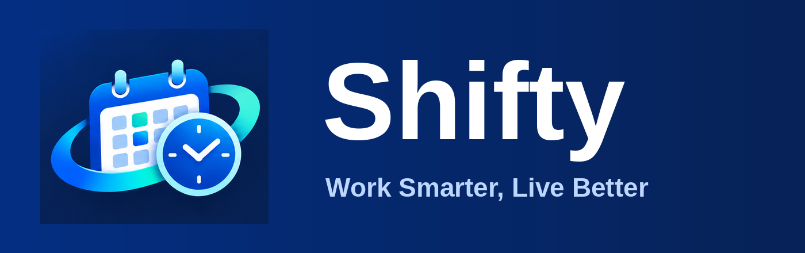

# Shifty: Work Time & Shift Manager
A ready-to-publish web app (already built, no build step). Your data stays in your browser (localStorage); there is no server.

## What it does
- Dashboard with live shift tracking, **clock in / out**, night-work time and a **weekly hour limit** warning
- Calendar with a day popup for shifts, events and tasks
- Reports with total completed salary, detailed salary calculation and an **invoice-style print**
- Earnings with overtime, night rate, **wage changes by date** and a **holiday rate**
- **Insights** tab: weekly hours, earnings charts, week view, shift planner, search and payday check
- Warnings on the dashboard for the weekly hour limit and the **annual income limit**
- **Weekly backup reminder** and automatic daily copies (last 7 days, kept on the device)
- Tools & security in Settings: calendar export, reports, PIN lock, cloud sync, deleted shifts
- Reminders, undo for deleted shifts, backup and restore (Japanese, English and Bengali)

## Publish on GitHub Pages
1. Upload every file in this folder to the top level of your repository (`index.html` must be at the top).
2. Settings → Pages → Source: **Deploy from a branch** → Branch **main** / **/ (root)** → Save.
3. Open `https://YOUR-USER.github.io/YOUR-REPO/`.

## Share with friends
1. Publish the app (steps above) and send your friends the link: `https://YOUR-USER.github.io/YOUR-REPO/`
   (inside the app: Settings → **Share & setup** → Share).
2. When a friend opens the link for the first time, a short **setup guide** asks for their language, name (optional),
   company and hourly wage (with currency), pay period closing day and payday, overtime and night rates,
   a usual shift, weekly hour limit and reminders.
3. Everyone's data stays private in their own browser. Nothing is sent to a server, so you cannot see their data and they cannot see yours.
4. Tell them to install it: Android (Chrome or Brave) menu ⋮ → Install app, iPhone (Safari) Share → Add to Home Screen.

You can run the guide again any time: Settings → Share & setup → Run setup again.

## Install as an app (Chrome or Brave)
- **Android:** menu ⋮ → **Install app** (or Add to Home screen).
- **Windows / Mac / Linux:** install icon at the right end of the address bar.
- **iPhone (Safari only):** Share → **Add to Home Screen**.

## Backup
Settings → Data & backup → Download. Records live only in the browser on each device.
